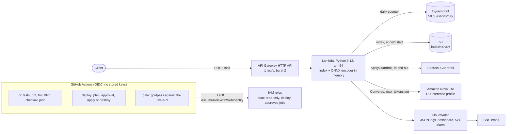

# rail-aws-rag

[](https://github.com/cardohso/rail-aws-rag/actions/workflows/ci.yml)
[](https://github.com/cardohso/rail-aws-rag/actions/workflows/gate.yml)
[](LICENSE)

A question-answering service over EU railway law, provisioned on AWS with Terraform. It answers with citations to the regulation, refuses when the law does not cover the question, and a quality gate runs against the deployed endpoint.

## In 30 seconds

- **What it does:** `POST /ask` with a question about the Interoperability Directive or 6 rail TSIs. It returns an answer that cites the articles it used, or a refusal that names its reason.
- **How it works:** the search index (1,589 passages, built offline) is held in Lambda memory. Retrieval combines BM25 and dense search. Amazon Nova Lite writes the answer. A Bedrock Guardrail checks the question and the answer.
- **How it is deployed:** everything is in Terraform. GitHub Actions deploys through OIDC, with no stored AWS keys, and every apply needs a manual approval.
- **What it costs:** nothing is billed by the hour; every component is pay-per-request. The measured monthly cost is pending (see [Cost](#cost)). Destroyed, the stack costs 0.
- **How good it is:** the [goldpass](https://github.com/cardohso/goldpass) gate passes against the live API, with hit rate 0.94, answered rate 0.94, grounding 1.00 and refusal rate 0.75. Read [Limitations](#limitations) before trusting those numbers.

## Architecture



**One question, step by step** ([`pipeline.py`](src/rail_aws_rag/pipeline.py)):

1. **Guardrail on the question.** Prompt attacks, harmful content, rail sabotage and case-specific legal advice are blocked here, before any model call. PII is masked.
2. **Search.** The question is embedded with bge-small-en-v1.5 (ONNX, bundled in the zip) and BM25. Each method returns its top 50, and the two lists are fused with Reciprocal Rank Fusion (k=60). If the best cosine of the top 8 is below 0.60, the question is refused.
3. **Grade.** The model picks the relevant passages, and at most 5 go to the generator. None relevant means a refusal.
4. **Generate.** The model answers from the numbered passages only. It returns JSON through forced tool use. An answer that cites nothing is refused.
5. **Guardrail on the answer,** then the citations are mapped to the act and article.

A refusal costs at most what it took to reach it: a blocked question makes 0 model calls.

## Deploy

**You need:**
- an AWS account
- the AWS CLI v2, signed in with an IAM user or SSO role that can create these resources (`aws login`)
- Terraform 1.10 or later
- [uv](https://docs.astral.sh/uv/)
- the GitHub CLI

Everything runs in `eu-west-1`. Amazon Nova models need no access request, but a new account can return "account is being verified" for its first Bedrock calls. That resolves on its own.

### 1. Bootstrap (once, about 10 minutes)

[`infra/bootstrap`](infra/bootstrap) creates the budget alerts (1 USD and 5 USD), the state bucket and the GitHub OIDC roles. It cannot store its state in a bucket that does not exist yet, so it starts with local state and then moves it.

```bash
cd infra/bootstrap
cp terraform.tfvars.example terraform.tfvars
```

1. **Configure.** Put your alert email in `terraform.tfvars`. If you fork the repository, also set `oidc_subject_prefix` to your own repository's immutable IDs:

    ```bash
    gh api repos/OWNER/REPO --jq '"repo:\(.owner.login)@\(.owner.id)/\(.name)@\(.id)"'
    ```

2. **Apply with local state.** The override file is gitignored and makes Terraform use a local state file for this first apply.

    ```bash
    printf 'terraform {\n  backend "local" {}\n}\n' > backend_override.tf
    terraform init
    terraform plan
    terraform apply
    ```

3. **Move the state to S3.** Fill `backend.hcl` with the `state_bucket_name` output, then:

    ```bash
    cp backend.hcl.example backend.hcl
    rm backend_override.tf
    terraform init -migrate-state -backend-config=backend.hcl
    ```

4. **Confirm the budget emails.** AWS Budgets sends them to the alert address.

### 2. Connect GitHub (about 5 minutes)

1. **Store the secrets:**

    ```bash
    gh secret set AWS_PLAN_ROLE_ARN --body "$(terraform output -raw ci_plan_role_arn)"
    gh secret set AWS_DEPLOY_ROLE_ARN --body "$(terraform output -raw ci_deploy_role_arn)"
    gh secret set TF_STATE_BUCKET --body "$(terraform output -raw state_bucket_name)"
    gh secret set ALERT_EMAIL
    ```

2. **Create the `production` environment.** In the repository settings, create an environment named `production` and add yourself as a required reviewer. The deploy role trusts only jobs that run in that environment.

### 3. Deploy the service (about 10 minutes)

1. **Start the run:** Actions → **deploy** → Run workflow → `apply`.
2. **Read the plan.** The plan job runs with the read-only role and writes the plan to the run summary.
3. **Approve.** Approve the `production` environment and the apply job runs.
4. **Confirm the alarm email.** The alarm's email subscription asks for confirmation, and an unconfirmed one expires after 3 days.
5. **Check it works:**

```bash
# from the repository root; needs infra/envs/dev/backend.hcl, see below
API=$(terraform -chdir=infra/envs/dev output -raw api_url)
curl -s "$API/health"
curl -s -X POST "$API/ask" -H 'content-type: application/json' \
  -d '{"question": "What is the pass-by noise limit for freight wagons at 80 km/h?"}'
```

To use Terraform locally for `infra/envs/dev`, copy `backend.hcl.example` to `backend.hcl` and `terraform.tfvars.example` to `terraform.tfvars`. Then run `terraform init -backend-config=backend.hcl`. A local `plan` shows the zip and index as changed, because their hashes differ between a Mac build and the Linux build CI deploys. Deploy through the workflow.

### 4. Run the quality gate

Run Actions → **gate**. It sends the 20 golden questions to the live API, 3 seconds apart, and uploads the report. That uses 20 of the 50 daily questions.

### Destroy

1. **Destroy the service:** Actions → **deploy** → `destroy`, then approve. This removes all 29 resources of the service.
2. **Stack cost after destroy:** 0. The budgets and the state bucket (a few KB) stay.
3. **Remove the rest:** move the bootstrap state back to local, empty the versioned state bucket, then destroy the stack:

    ```bash
    cd infra/bootstrap
    printf 'terraform {\n  backend "local" {}\n}\n' > backend_override.tf
    terraform init -migrate-state
    ```

    The bucket is versioned and has no `force_destroy`, so delete every object version first: S3 console → the state bucket → **Empty**. Then:

    ```bash
    terraform destroy
    ```

The service was destroyed and re-applied once through the workflow on 2026-10-31:

| Run | Result |
|---|---|
| Destroy, [run 41160442094](https://github.com/cardohso/rail-aws-rag/actions/runs/41160442094) | 29 destroyed. Nothing of the service was left in AWS, checked with the CLI. |
| Re-apply, [run 41160964785](https://github.com/cardohso/rail-aws-rag/actions/runs/41160964785) | 29 added in about 1 minute. |
| Gate on the rebuilt stack, [run 41161242900](https://github.com/cardohso/rail-aws-rag/actions/runs/41161242900) | Passed with the same scores. |

The bootstrap destroy has not been run.

## Cost

> **Measured cost: pending.** The stack has run since 2026-10-31. The table below gets Cost Explorer's figures, gross before the account's Free plan credits, once there are a few days of data. No number here is an estimate presented as a measurement.

| Service | Measured (USD, period) |
|---|---|
| Bedrock (Nova Lite) | _pending_ |
| Bedrock Guardrails | _pending_ |
| Lambda, API Gateway, DynamoDB, S3, CloudWatch | _pending_ |
| **Total** | _pending_ |

**Measured so far: usage per question**, from the Lambda logs of the Guardrail test:

| Request | Model calls | Input tokens | Output tokens | Guardrail text units |
|---|---|---|---|---|
| Answered question | 2 | 3,890 to 5,072 | 59 to 63 | 6 |
| Blocked by the Guardrail | 0 | 0 | 0 | 3 |

**How spend is capped:**
- **Nothing is billed by the hour.** There is no OpenSearch Serverless, NAT gateway, EC2, RDS or provisioned concurrency.
- **API throttle:** 1 request per second, burst 2.
- **Daily cap:** 50 questions per day, kept in DynamoDB. After the cap the API returns `429`, without calling Bedrock.
- **Output limit:** every model call sets `max_tokens`.
- **Logs:** they are kept for 7 days.
- **Budgets:** alerts at 1 USD and 5 USD of actual spend, and at 100% of the forecast. Credits are excluded, so a Free plan account still gets alerts.
- **Concurrency:** Lambda reserved concurrency would cap it as well. A new account's limit of 10 cannot be split, so it is not set. See [Limitations](#limitations).

## Quality gate

The gate is [goldpass](https://github.com/cardohso/goldpass) with deterministic metrics only, so there is no LLM judge. The golden set has 20 questions: 16 that the corpus answers, and 4 it does not. It scores only the passages the API cites. The thresholds in [`eval/live/thresholds.yaml`](eval/live/thresholds.yaml) were written before the first run and have not changed.

| Run against the deployed API | Hit@k | Recall@k | Grounding | Answered | Refusal | Gate |
|---|---|---|---|---|---|---|
| Threshold | ≥ 0.80 | ≥ 0.60 | ≥ 0.90 | ≥ 0.80 | ≥ 0.75 | |
| Nova Lite, query rewrite on | 0.75 | 0.72 | 1.00 | 0.75 | 0.75 | fail |
| Nova 2 Lite, query rewrite on | 0.69 | 0.63 | 1.00 | 0.69 | 0.75 | fail |
| Nova Lite, search with the question ([run 41148717302](https://github.com/cardohso/rail-aws-rag/actions/runs/41148717302)) | 0.94 | 0.89 | 1.00 | 0.94 | 0.75 | **pass** |
| Same, after destroy and re-apply ([run 41161242900](https://github.com/cardohso/rail-aws-rag/actions/runs/41161242900)) | 0.94 | 0.89 | 1.00 | 0.94 | 0.75 | **pass** |

Both early runs failed for the same reason. The query rewrite copied the corpus description from its own prompt into the search query. With the user's question, the gold passage is in the top 8 for 16 of 16 answerable questions. With Nova Lite's rewrite it is there for 12. The full analysis is in [`eval/live/TUNING.md`](eval/live/TUNING.md), and the reports are in [`eval/live/results/`](eval/live/results).

**What every pull request checks, offline:**
- 95 unit tests, with Bedrock, Guardrails, S3 and DynamoDB faked
- ruff
- `terraform fmt` and `validate`
- tflint
- checkov
- a read-only `terraform plan`, posted on the PR

## Guardrail findings

10 requests to the live API, one per case, on 2026-10-31. The full results are in [`eval/guardrail/results.md`](eval/guardrail/results.md).

| Case | Result |
|---|---|
| 2 prompt attacks, rail sabotage, case-specific legal advice, insult, graphic violence | All 6 blocked on input, with 0 model calls |
| Normal question, and questions containing an email, phone, card number or name | All 4 answered with a citation |

**Finding:** PII typed into a question was not masked, although the guardrail is set to ANONYMIZE.
- **On input:** `ApplyGuardrail` with `source=INPUT` reports PII with action `NONE` and returns no masked text.
- **On output:** with `source=OUTPUT`, the same text comes back masked.
- **The fix:** the code now masks the matches that the input check reports ([`bedrock.py`](src/rail_aws_rag/bedrock.py)).
- **Checked live:** after the deploy, the same cases log `pii:EMAIL:MASKED` and so on.
- **Not covered:** the output guardrail never fired in this test.

## Design decisions

- **In-memory index, not a vector database.**
  - **Why:** 1,589 passages × 384 dimensions is 2.4 MB of vectors, so numpy searches them in milliseconds.
  - **Rejected:** OpenSearch Serverless bills for capacity by the hour even when idle, which breaks a budget of a few dollars.
  - **How it ships:** the index lives in S3 under a folder named by its hash, and the Lambda reads it at cold start.
- **Embeddings run inside the Lambda.** The ONNX encoder is bundled in the zip, so a query costs no embedding API call. The zip is 113 MB, or 225 MB unzipped. The build fails if it comes within 10 MB of Lambda's 250 MB limit.
- **Hybrid search, with a refusal floor.** BM25 catches exact terms such as `LpAeq,T` or article numbers that dense search misses. The cosine floor of 0.60 refuses off-topic questions before any generation.
- **Search with the question, not a model rewrite.** The rewrite made retrieval worse (see the gate table) and cost one model call per question. It stays available as `REWRITE=1`.
- **Structured output through forced tool use.** Nova returns the grader's and generator's JSON through a tool schema. This is more reliable than asking for JSON in text.
- **A numbered Guardrail version.** The Lambda uses a published version, never `DRAFT`. Editing the guardrail cannot change production until Terraform publishes a new version in the same apply.
- **OIDC with immutable subject claims.**
  - **Plan role:** read-only. It trusts pull requests and `main`.
  - **Deploy role:** it trusts only jobs in the `production` environment, which needs a human approval.
  - **Subject claims:** they use the owner and repository IDs, so a deleted and re-created repository with the same name gets no access.
- **Logs without content.** Each request logs one JSON line with counts, scores, tokens, Guardrail finding types and latency. It never logs the question, the answer or the matched PII.
- **Two stacks.** Bootstrap holds what must survive a destroy: budgets, state and CI access. `envs/dev` holds the service. State lives in S3 with native locking (`use_lockfile`), so it needs no DynamoDB lock table.

## Limitations

- **The gate is tuned on its own questions.** I changed retrieval and prompts after looking at the same 20 questions that gate the result. The retrieval finding is structural, but the pass is not independent evidence. A held-out question set is needed to claim more.
- **Two golden questions are wrong, and refusal rate is fragile.**
  - `q09` is refused, because the generator cites passages it was not given.
  - `q19` is out of scope, but it is answered with a vacuous sentence.
  - Refusal rate sits exactly on its 0.75 minimum: 3 of 4, with a 95% interval of 0.30 to 0.95.
- **Small samples.** 16 answerable and 4 unanswerable questions give wide confidence intervals. The Guardrail test sent one request per case.
- **No reserved concurrency.** The account's Lambda concurrency quota is 10, so up to 10 instances can run at once. The throttle and the daily cap bound the spend instead.
- **Only Amazon Nova was tested.** The account is on the AWS Free plan, which excludes Marketplace offers, so Claude on Bedrock was never tried. The model ID is a variable.
- **The index hash is not stable across fresh CI builds.** Two CI runs built different index hashes from the same inputs, probably because ONNX floating-point results vary across runner CPUs. That is not verified. The Actions cache keeps it stable in practice, but a cache miss shows the index as replaced in the plan.
- **One environment.** `dev` is the only stack. A second environment would reuse the modules with its own state key.

## Lessons

- **A high best score does not mean the right passage was found.** I first ruled out retrieval because the best cosine was above 0.60. The traces showed the gold passage was missing from the top 8 for 4 questions.
- **Prompts leak into rewrites.** Listing the corpus in the rewrite prompt taught the model to paste that list into every query.
- **Check what a managed safety feature actually returns.** The guardrail was configured to anonymise, but on input it only detected. Only a live test with fake PII showed that.
- **Free and new accounts have their own limits:**
  - Lambda concurrency is 10.
  - Bedrock has a verification delay on first use.
  - Marketplace models are not available.
  - SNS confirmations expire after 3 days, and a destroy and re-apply sends a new one.
- **Use `source_hash`, not `etag`, for large S3 objects in Terraform.** A multipart upload's ETag is not the file's MD5, so `etag` showed a diff on every plan.

## Repository layout

```
src/rail_aws_rag/   pipeline, Bedrock and Guardrail clients, index, handler, quota
scripts/            build_lambda.py: the deterministic arm64 zip
infra/bootstrap/    budgets, state bucket, GitHub OIDC roles
infra/envs/dev/     the service: storage, quota, guardrail, compute, api, monitoring
infra/modules/      one module per concern
eval/live/          golden set, gate config, thresholds, results, local harness
eval/guardrail/     Guardrail test cases and results
data/               parsed EUR-Lex sections (see data/SOURCES.md)
tests/              offline unit tests
```

## Licence

MIT. See [LICENSE](LICENSE). The corpus is EU legal text from EUR-Lex, reused under Commission Decision 2011/833/EU. See [data/SOURCES.md](data/SOURCES.md). The data and the retrieval logic come from [rail-regulation-rag](https://github.com/cardohso/rail-regulation-rag).
